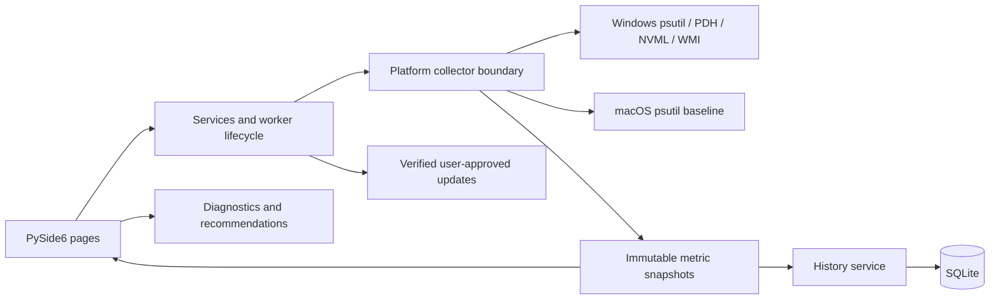

# NEXUS

NEXUS is an open-source, offline-first desktop application for real-time system monitoring, hardware diagnostics, process inspection, storage analysis, performance history, and cautious optimization guidance.

**Current version:** `1.0.0-rc.1` · **License:** [MIT](LICENSE) · **Status:** Windows release candidate; macOS implementation pending native verification.

> NEXUS reports measured facts and unavailable capabilities honestly. It does not promise FPS gains, silently optimize the machine, or upload telemetry.

## What it provides

- Live CPU, memory, disk, network, and available GPU telemetry.
- Hardware capability and sensor availability reporting.
- Process listing, details, and explicitly confirmed graceful termination with PID identity checks.
- Read-only startup review and platform-specific diagnostics.
- Storage analysis for a folder selected by the user.
- Explainable health scoring and recommendations based on measured pressure.
- Local SQLite performance history, reports, and a manual gaming-session recorder.
- Optional checksum-verified update discovery.
- Windows per-user installer with Start Menu integration.

## Platform status

| Platform | Architecture | Status |
|---|---|---|
| Windows 10/11 | x64 | Implemented; executable and Inno Setup installer built locally |
| macOS 14.4+ | Apple Silicon ARM64 | Source backend and native CI path prepared; runner/device verification pending |
| macOS 14.4+ | Intel x64 | Source backend and native CI path prepared; runner/device verification pending |

The macOS baseline reports unified system memory once and does not invent dedicated VRAM. GPU utilization, thermal, fan, power, CPU temperature/frequency, and memory-pressure metrics remain unavailable until validated least-privilege sources are added.

## Architecture



Shared metric models, pages, charts, history, reports, storage scanning, and scoring remain platform-neutral. Native bindings are imported only on the selected platform.

## Windows installation

The release installer is `NEXUS-Setup-<version>-x64.exe`. It installs per-user to `%LOCALAPPDATA%\Programs\NEXUS`, creates a Start Menu shortcut named **NEXUS**, and offers an optional desktop shortcut. Press the Windows key, type `NEXUS`, and launch the installed app. See [Windows installation](docs/WINDOWS_INSTALLATION.md) and [installation details](docs/INSTALLATION.md).

The current local installer is `release/NEXUS-Setup-1.0.0-rc.1-x64.exe`. It is unsigned; verify checksums and expect SmartScreen to identify unsigned pre-release software.

## macOS installation

Architecture-specific DMGs are prepared by GitHub Actions but have not run from this checkout. Do not treat macOS support as release-verified yet. See [macOS installation](docs/MACOS_INSTALLATION.md), [build instructions](docs/MACOS_BUILD_INSTRUCTIONS.md), and [testing](docs/MACOS_TESTING.md).

## Build from source

```powershell
python -m pip install -r requirements.txt
python -m nexus
python -m pytest -o addopts='' -q
```

Windows packaging:

```powershell
scripts\build_windows.ps1
scripts\build_installer.ps1
```

macOS packaging must run on macOS:

```sh
python3 -m pip install -e '.[dev,build]'
bash scripts/build_macos.sh
bash scripts/build_dmg.sh
```

See [build from source](docs/BUILD_FROM_SOURCE.md), [Windows build instructions](docs/BUILD_INSTRUCTIONS.md), and [release process](docs/RELEASE_PROCESS.md).

## Testing

```powershell
python -m pytest -o addopts='' -q
python -m compileall -q nexus tests scripts
python -m pip check
```

The latest local result is **97 passed, 2 skipped** on Windows. Native macOS runner and device results are pending.

## Privacy and security

NEXUS stores settings, history, logs, and exports locally. It has no telemetry service. Update checks are optional and disabled until a publisher configures a repository. Downloaded update assets are checked against SHA-256 and still require user approval. Read [SECURITY.md](SECURITY.md) and [third-party notices](docs/THIRD_PARTY_NOTICES.md).

## Contributing and support

Read [CONTRIBUTING.md](CONTRIBUTING.md), [CODE_OF_CONDUCT.md](CODE_OF_CONDUCT.md), and [SUPPORT.md](SUPPORT.md). The project currently has no configured GitHub remote; do not assume issue or discussion links exist.

## Roadmap and release readiness

The roadmap prioritizes native macOS verification, signed/notarized distribution, Windows clean-machine installer testing, and additional validated hardware sources. See [release readiness](docs/GITHUB_RELEASE_READINESS.md), [development status](docs/DEVELOPMENT_STATUS.md), and [macOS roadmap](docs/MACOS_ROADMAP.md).

## Acknowledgments

NEXUS is built with Python, PySide6/Qt, psutil, pyqtgraph, NumPy, SQLite, PyInstaller, and optional Windows platform bindings. Exact resolved versions and license obligations are recorded in [THIRD_PARTY_NOTICES.md](docs/THIRD_PARTY_NOTICES.md).
