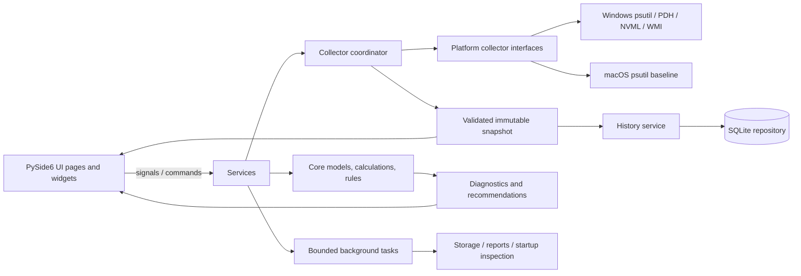
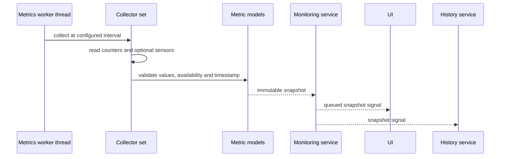
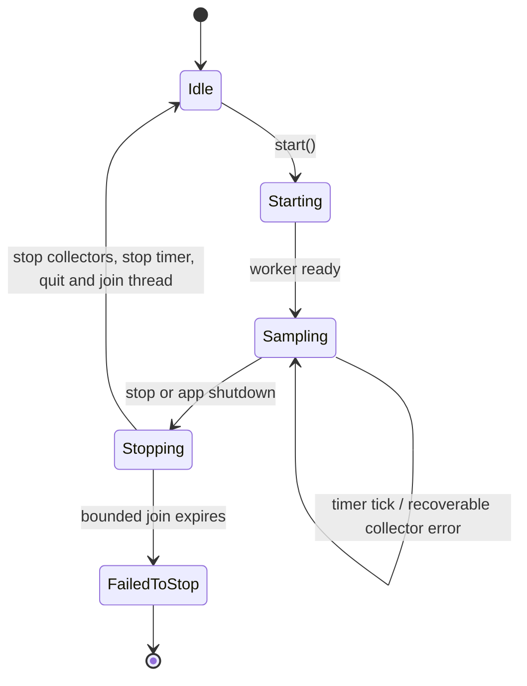

# Proposed architecture

Cross-platform expansion research and the compatibility plan are in `MACOS_RESEARCH.md`, `MACOS_ARCHITECTURE.md`, and `PLATFORM_COMPATIBILITY.md`. macOS implementation and native build workflows are present locally; native verification and release support remain pending.

The existing module layout is suitable as a starting point. Preserve it unless implementation evidence justifies a focused change.

## Responsibilities
- `nexus/platforms`: OS and architecture selection; platform implementations are imported lazily so one OS does not import another OS's native bindings. The macOS backend is selected lazily; native runtime verification remains pending.
- `nexus/core`: immutable data models, calculations, policy and domain rules; no Qt widgets or platform calls.
- `nexus/hardware`: bounded platform collectors. Shared interface returns measurements plus capability/availability and warnings. Windows-specific APIs stay in Windows modules.
- `nexus/services`: lifecycle, scheduling, settings, history coordination and background jobs; Qt signals marshal results to UI.
- `nexus/database`: schema, migrations, transactions, repository. SQLite access is serialized; UI does not issue raw SQL.
- `nexus/ui`: rendering and user actions only; long tasks always backgrounded and cancellable.
- `nexus/utils`: cross-cutting paths, formatting, logging and narrow platform helpers.

## Data and runtime contracts
- Use typed immutable snapshots. Each field is a value or unavailable state with unit, source/capability, wall timestamp and monotonic collection time as appropriate.
- Counter-derived rates use deltas over monotonic elapsed time; reset, first sample, invalid interval, or device disappearance yields unavailable rather than zero.
- Persist UTC epoch timestamps (or explicit UTC ISO-8601) and display local time; use monotonic time only for elapsed durations.
- Keep latest snapshot in memory; persist at configured cadence, retention cleanup transactionally, and bound chart history. Export CSV/JSON/HTML only on user request.
- Set explicit SQLite busy timeout, foreign keys, schema version/migrations, and graceful fallback if history unavailable.
- One bounded monitoring worker owns collectors. Per-page jobs should be limited and cancellable. Avoid synchronous joins from a worker thread or blocking UI on indefinite work.
- Sampling default target 2 seconds; user setting 1–60 seconds. Poll no faster than 250 ms internally absent evidence. Proposed budgets (not measured results): idle CPU average <=1% over 10 minutes; active monitoring average <=3% over 10 minutes at 2-second sampling; process private bytes <=200 MiB after 5-minute warm-up; cold start to interactive dashboard <=5 seconds on reference Windows hardware; UI input-to-paint p95 <=100 ms under ordinary monitoring; chart updates <=2 Hz per displayed chart and no more often than new samples; process refresh no faster than every 2 seconds; history DB+WAL <=100 MiB for 30 days at 2-second sampling after configured retention cleanup; worker shutdown <=3 seconds normally and <=5 seconds hard timeout. Measure using a documented reference machine and repeatable protocol; targets are not claims and may be revised from evidence.
- Baseline metrics should record process CPU and system CPU context, private bytes, startup duration, sample collection duration, chart update cadence, process refresh cadence, DB/WAL size over time, and shutdown latency. Do not run stress workloads to measure these budgets.
- Storage scans are user-triggered, read-only, single active scan, cancellable, skip reparse points and report inaccessible paths.

## Security and platform policy
Standard-user operation by default. Process actions revalidate PID/name/identity and require a clear confirmation; startup registration is a user-confirmed per-user setting. No deletion, registry tuning, security changes, hidden network access, or telemetry. Capabilities are detected per backend and failures isolated. Future macOS implementation must satisfy the shared contracts, not import Windows APIs.

## Key trade-offs
Single worker simplifies collector ownership and avoids UI stalls but a slow sensor can delay the entire sample; optional backend timeouts/isolation should be considered after measured evidence. SQLite is simple/offline but needs bounded write cadence and retention. A shared Qt app preserves existing investment but GUI packaging and cross-platform testing remain costs.
